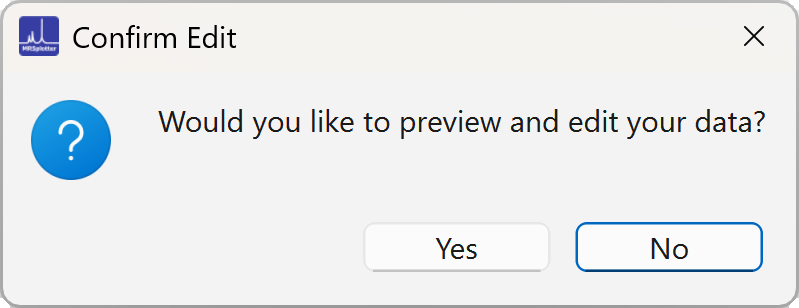
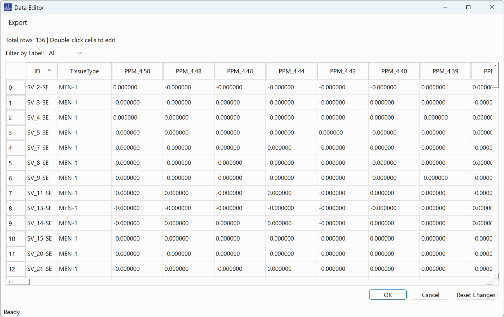
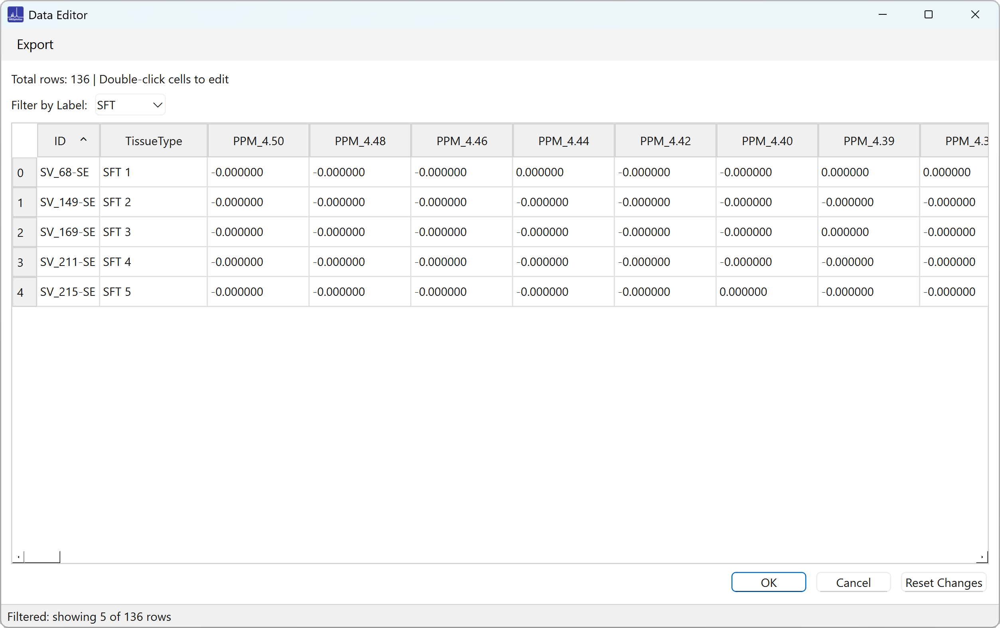
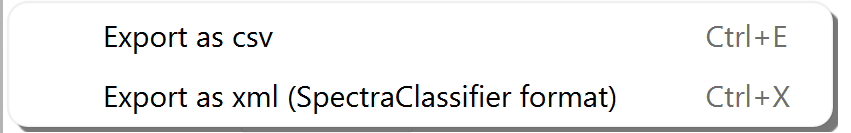
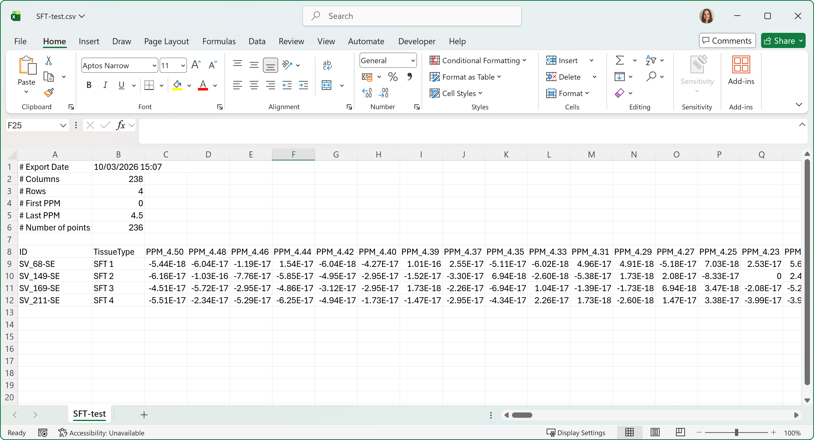
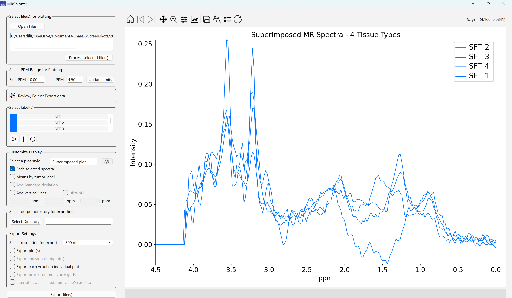

# Review, edit, and export data

{width="400"}

The displayed data can be previewed by clicking the file icon. A confirmation window appears (Figure 9) to verify the action. This may take a while for large files.

{width="400"}

*Figure 9. Confirm opening the data edit window.*

Once confirmed, the data editor window opens (Figure 10). It provides an interface for viewing, filtering, and modifying the data.

*Figure 10. Data editor window.*

## Filtering by label

Below the menu bar is a filtering section that lets you filter the data by tissue type label. The **Filter by Label** dropdown offers the option to view **All** data or a specific tissue type present in the dataset. When a tissue type is selected, only the rows with that tissue type are displayed, and the status bar updates to show the number of filtered rows (Figure 11).

*Figure 11. Example of filtering.*

## The data table

The rest of the window is occupied by a sortable data table with the following columns:

- **ID**: identifying information for each spectrum
- **TissueType**: classification of the tissue type for each spectrum
- **PPM value columns**: the spectral data, filtered to the selected ppm range

You can interact with the table in several ways:

- Double-click cells to edit values directly
- Sort the data by clicking column headers
- Select multiple cells or rows to copy data

Keyboard shortcuts:

| Shortcut | Action |
|---|---|
| <kbd>Ctrl</kbd>+<kbd>C</kbd> | Copy selected cells |
| <kbd>Ctrl</kbd>+<kbd>V</kbd> | Paste data from the clipboard |
| <kbd>Ctrl</kbd>+<kbd>A</kbd> | Select all cells |
| <kbd>F11</kbd> | Toggle full screen mode |

## Exporting the data

The menu bar has an **Export** option for saving the current data selection (Figure 12).

{width="400"}

*Figure 12. Export options.*

The first option exports a **CSV** file, which can be opened and edited in other applications such as text editors or Excel (Figure 13). The other export format follows the **SpectraClassifier** data format, which is the same for single-voxel and multivoxel data, so the XML files can be integrated seamlessly into existing analysis pipelines.

At the bottom of the window, **OK** saves all modifications and returns to the main interface, while **Cancel** closes the window without applying any changes. If you try to close the window with unsaved changes, a confirmation dialog asks whether to save them first, preventing accidental data loss.

*Figure 13. Exported SFT data opened with Excel.*

Changing the labels gives you flexibility. For example, Figure 14 shows the result when the label is changed from the tissue type to the case ID.

*Figure 14. Unique SFT cases.*
