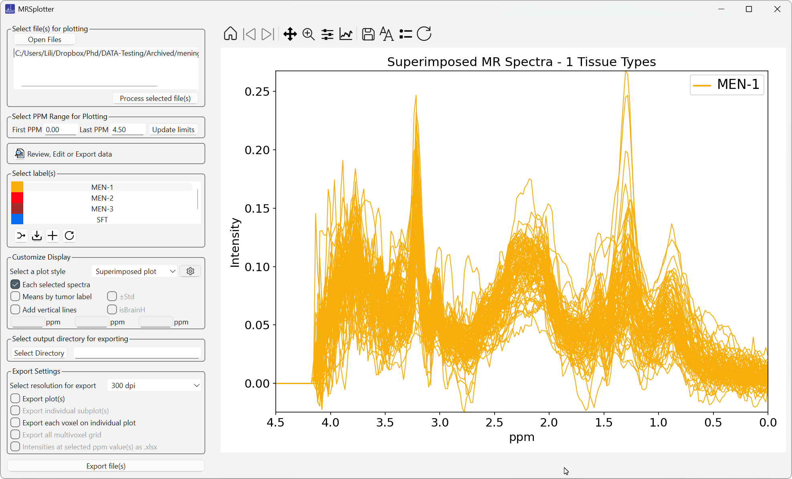
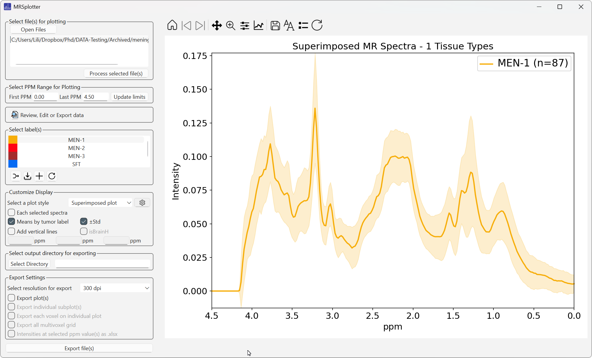
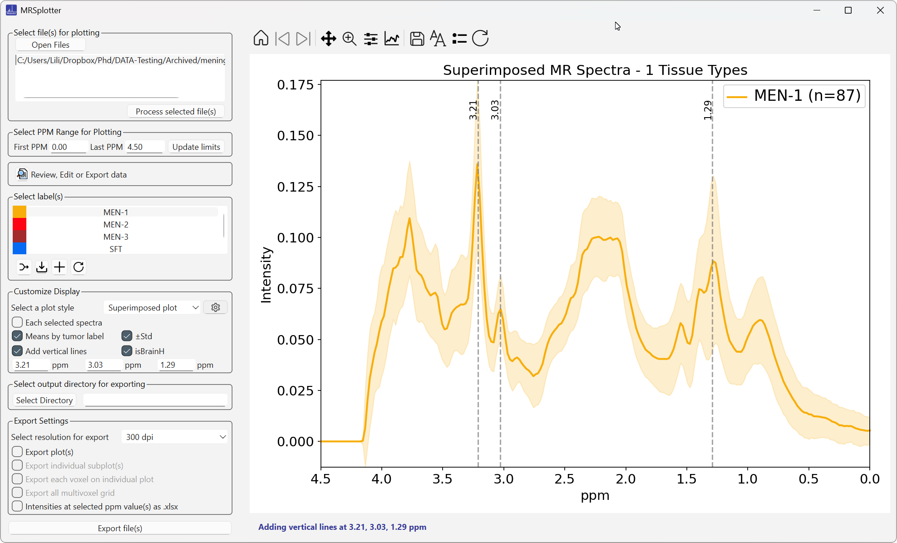

# Display configuration

## Each selected spectra

When selected, the spectrum of each case is shown, as in Figure 26.

*Figure 26. Each selected spectrum of meningioma grade 1 (short echo) on a superimposed plot.*

## Means by tumor label

When selected, the mean spectrum of each class is shown. If **Each selected spectra** is also selected, the mean of each label is plotted with a darker and thicker version of the chosen color to avoid confusion.

## Add standard deviation

Available when **Means by tumor label** is selected (Figure 27).

*Figure 27. Mean and standard deviation of meningioma grade 1 (short echo) on subplots.*

## Add vertical lines

Adds reference lines at key metabolite positions to make peak assessment easier. When **isBrainH** is selected, the fields are automatically filled with 1.29, 3.03, and 3.21 ppm. Up to three values can be used at the same time (Figure 28).

*Figure 28. Mean spectra of meningioma grade 1 with vertical lines at 3.21, 3.03, and 1.29 ppm.*
