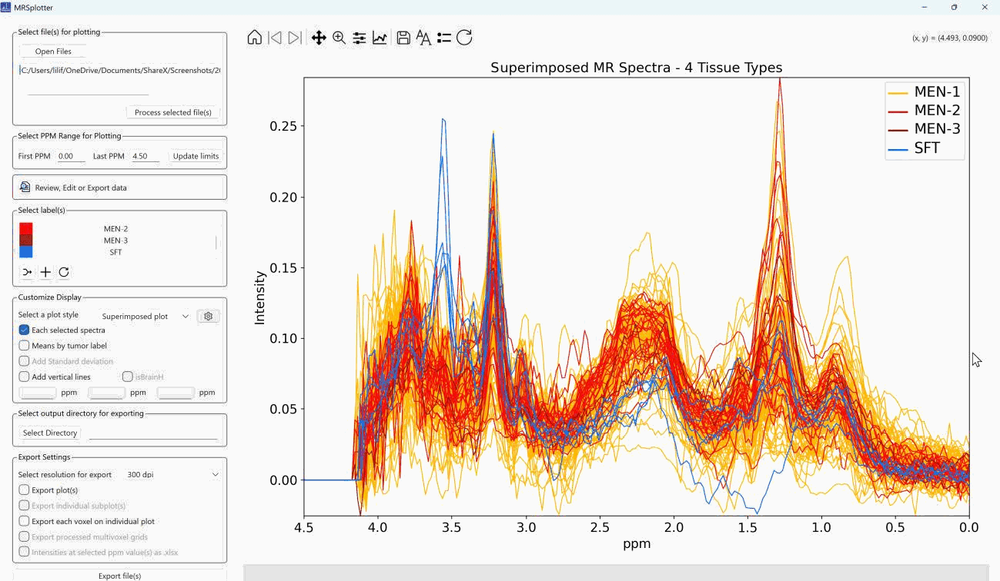
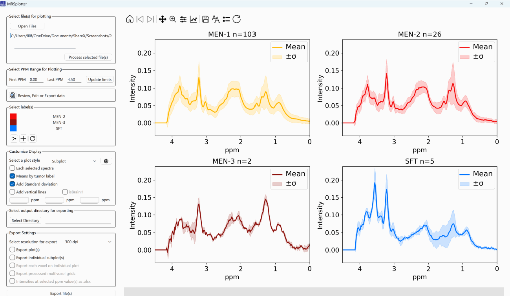
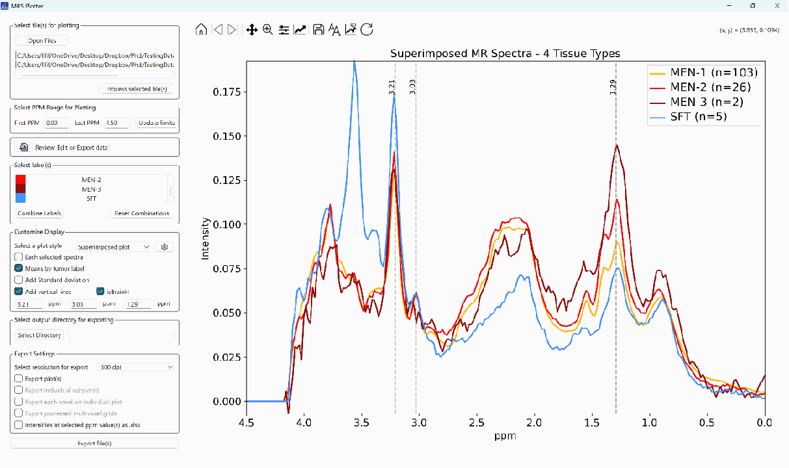
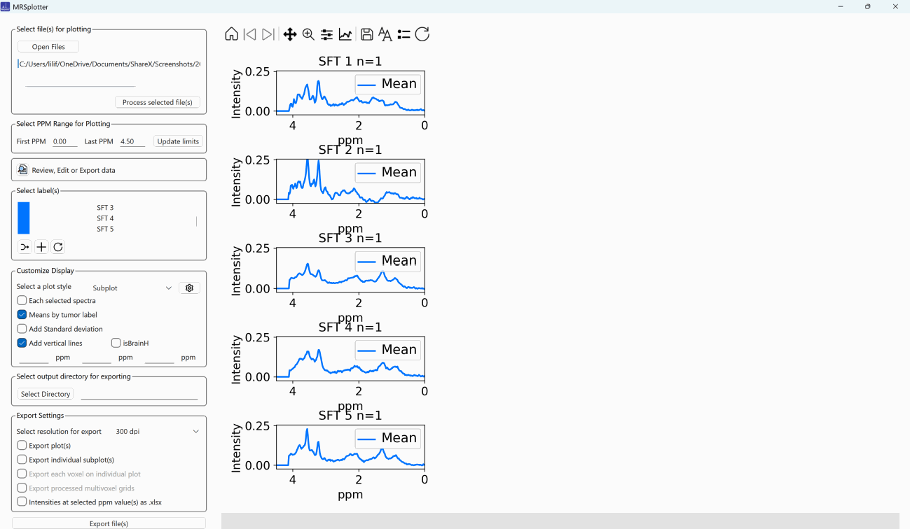

## Display configuration

### Each selected spectrum

When selected, the spectrum of each case is shown, as in Figure 18.

*Figure 18. Each selected spectrum of the meningioma dataset (short echo) on a superimposed plot.*

### Means by tumor label

When selected, the mean spectrum of each class is shown. If **Each selected spectra** is also selected, the mean of each label is plotted with a darker and thicker version of the chosen color to avoid confusion.

### Add standard deviation

Available when **Means by tumor label** is selected (Figure 19).

*Figure 19. Mean and standard deviation of the meningioma dataset (short echo) on subplots.*

### Add vertical lines

Adds reference lines at key metabolite positions to make peak assessment easier. When **isBrainH** is selected, the fields are automatically filled with 1.29, 3.03, and 3.21 ppm. Up to three values can be used at the same time (Figure 20).

*Figure 20. Mean spectra of meningiomas with vertical lines at 3.2, 3.03, and 1.29 ppm.*

*Figure 22. Short echo spectra of SFTs.*
