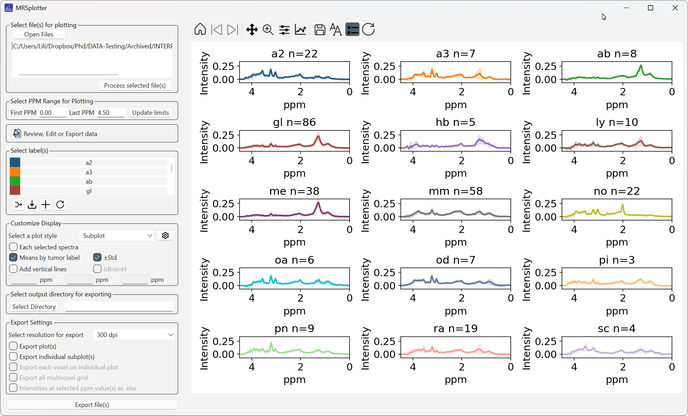
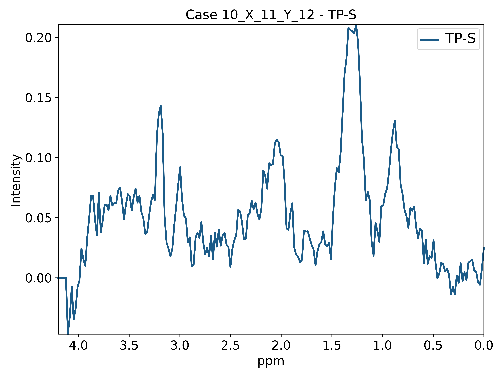
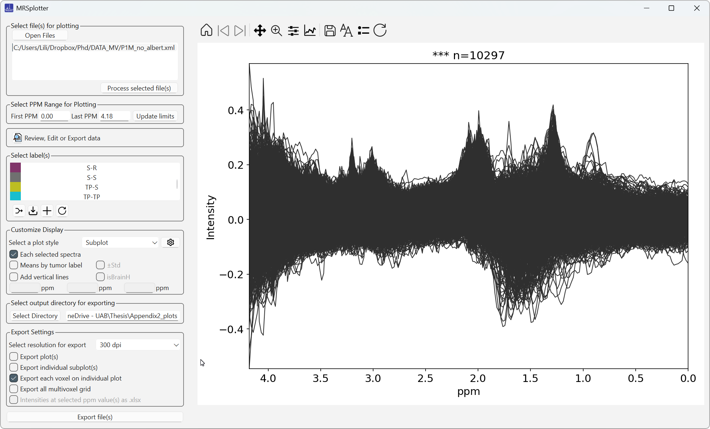

# Examples

## Large number of labels: INTERPRET dataset

When the selection contains more than 10 tissue types, the generated labels are made smaller to fit better (Figure 38). Dataset from reference [5](references.md).

*Figure 38. Superimposed plot of the INTERPRET dataset. With many labels, the fontsize of the legends are reduced.*

As Figure 39 shows, when many labels are selected, the individual plots become squished and the legends overlap. The legends can be removed from individual plots, or from all of them at once with the toolbar. When exported, however, the image is proportional (Figure 40).

*Figure 39. Subplots of the INTERPRET dataset. With many labels, the individual plots become squished and the legends overlap.*

*Figure 40. The previous figure when exported.*

## Large number of spectra: Multivoxel dataset

This example uses the pseudoprogression multivoxel dataset from reference [6](references.md) (Figure 41).

*Figure 41. Labels from the pseudoprogression multivoxel dataset with legends removed.*

Figure 42 shows an exported voxel from a multivoxel case. The x and y positions are shown in the title and in the filename.

*Figure 42. Exported spectrum of a single voxel of a multivoxel case. The x and y positions are noted in the title and in the name of the exported file.*

!!! note "Performance with large datasets"
    Handling many spectra, for example from a multivoxel dataset, can be slow, and the application may take a while to respond (Figure 43). Because the plots are regenerated after each change, be cautious when plotting thousands of spectra.

*Figure 43. 10,297 spectra labelled '\*\*\*' from the pseudoprogression dataset (mean in dark blue).*

When **Multivoxel grid** is selected, only the first case is shown (Figure 44), but as the status bar indicates, all processed cases are exported in the background. Figure 45 shows one of these exported grids.

*Figure 44. When the multivoxel grid plot type is selected, only one case is shown, but as the status bar shows (blue rectangle), all processed cases can be exported.*

*Figure 45. One of the exported multivoxel grids.*
