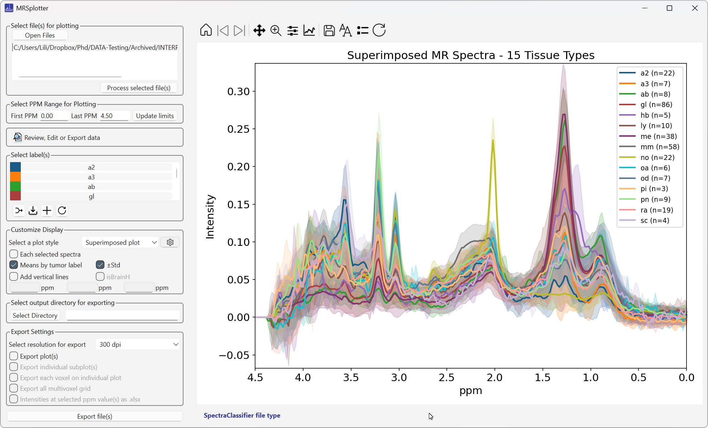
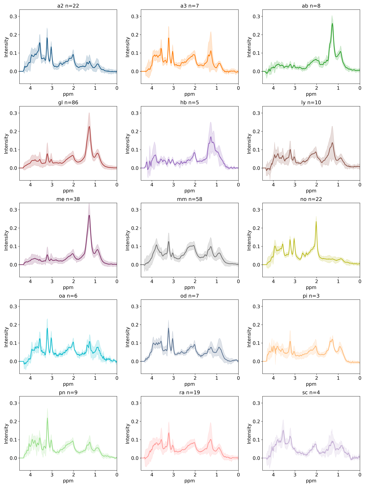
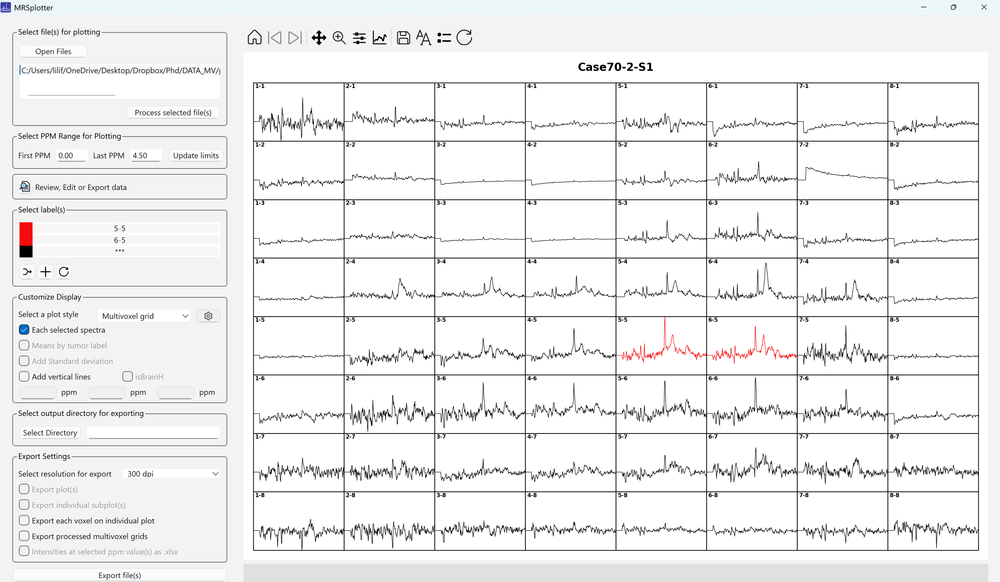

# Examples

## Large number of labels: INTERPRET dataset

When the selection contains more than 10 tissue types, the generated labels are made smaller to fit better. Dataset from reference [5](references.md).

As Figure 29 shows, when many labels are selected, the individual plots become squished and the legends overlap. The legends can be removed from individual plots, or from all of them at once with the toolbar (Figure 30). When exported, however, the image is proportional (Figure 31).

*Figure 29. Labels from the pseudoprogression multivoxel dataset.*

*Figure 31. The previous figure when exported.*

## Large number of spectra: Multivoxel dataset

This example uses the pseudoprogression multivoxel dataset from reference [6](references.md).

*Figure 30. Labels from the pseudoprogression multivoxel dataset with legends removed.*

Figure 32 shows an exported voxel from a multivoxel case. The x and y positions are shown in the title and in the filename.

*Figure 32. Exported spectrum of a single voxel of a multivoxel case. The x and y positions are noted in the title and in the name of the exported file.*

!!! note "Performance with large datasets"
    Handling many spectra, for example from a multivoxel dataset, can be slow, and the application may take a while to respond (Figure 33). Because the plots are regenerated after each change, be cautious when plotting thousands of spectra.

*Figure 33. 10,297 spectra labelled '\*\*\*' from the pseudoprogression dataset (mean in dark blue).*

When **Multivoxel grid** is selected, only the first case is shown (Figure 34), but as the status bar indicates, all processed cases are exported in the background. Figure 35 shows one of these exported grids.

*Figure 34. When the multivoxel grid plot type is selected, only one case is shown, but as the status bar shows (blue rectangle), all processed cases can be exported.*

