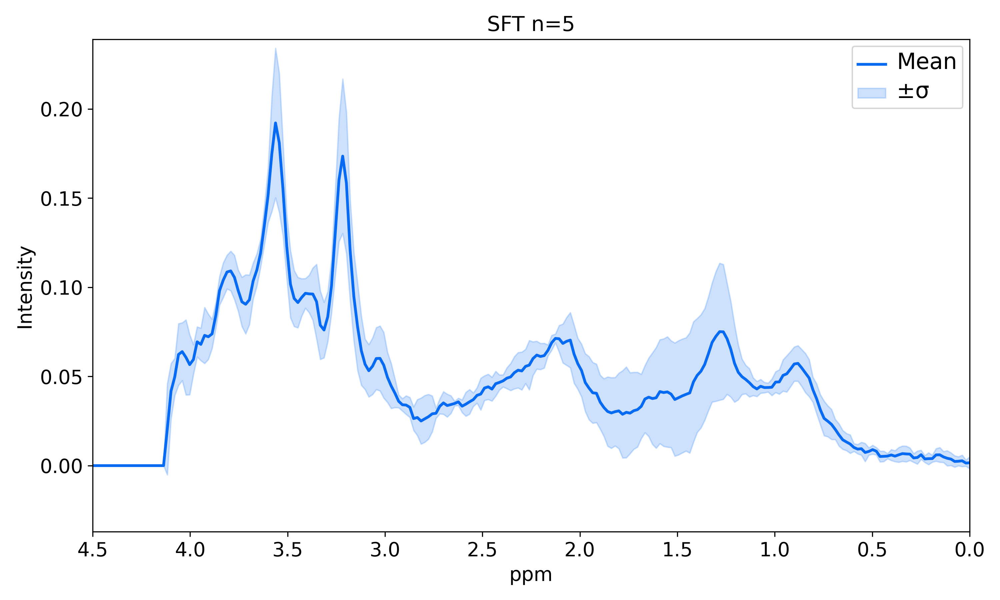
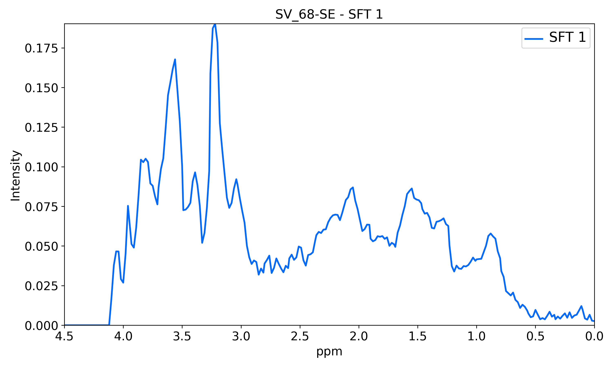
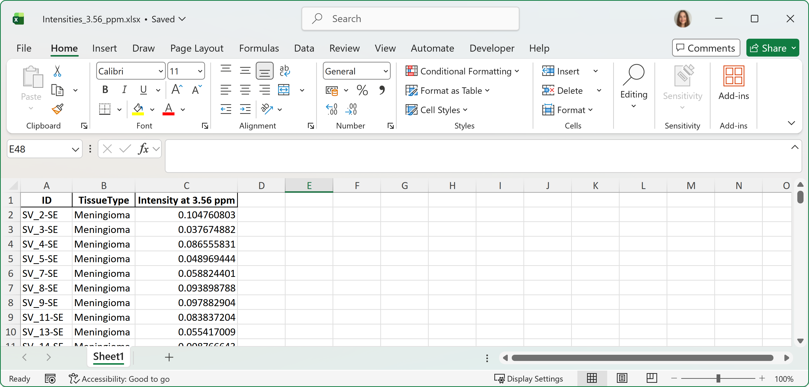

# Exporting

## Output directory

An output directory must be specified if any of the export options are selected.

## Resolution

Plots can be exported at 300 (default), 600, or 800 dpi.

## Export plot(s)

Exports the displayed plot or subplots with predetermined settings. The generated filename contains information about the selected plotting options (Figure 33).

*Figure 33. Exported subplots.*

## Export individual subplot(s)

Available when the plot style is set to **Subplot**. Each subplot is exported separately with predetermined settings (Figure 34).

*Figure 34. Exported single subplot.*

## Export each case on an individual plot

Available only when **Each selected spectra** is selected. Creates one plot per case. Because this can produce many plots, it runs in the background: the plots are exported directly without being displayed. The file currently being exported is shown in the status bar at the bottom of the application (Figure 35).

*Figure 35. Exported single case.*

## Export multivoxel grids

Available only when the plot style is **Multivoxel grid**. Creates a multivoxel grid plot for each case. Like the option above, this runs in the background and shows the file currently being exported in the status bar (Figure 36).

*Figure 36. Exported multivoxel grid.*

## Intensities at selected ppm value(s) as xlsx

Available only when **Add vertical lines** is selected. When at least one box contains a ppm value, the intensities of the selected cases at those positions are exported to the output directory as an Excel file (Figure 37).

*Figure 37. Example of the Excel output.*
