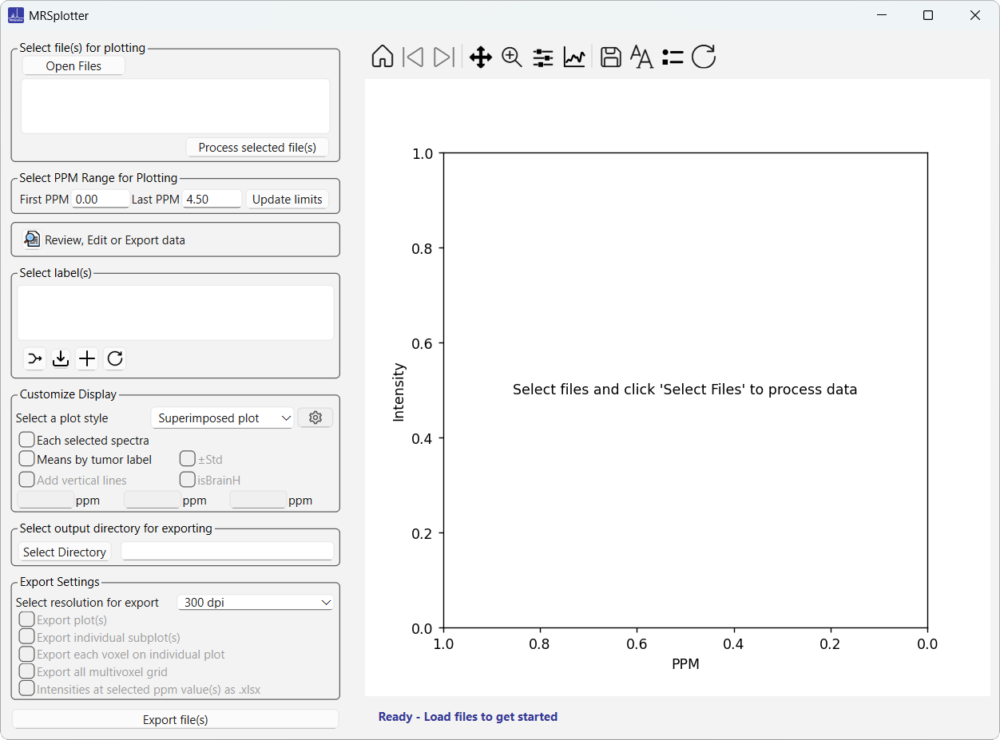

# MRSplotter

{ width="90" }

Open source software for visualizing and generating publication-ready plots from processed 1H magnetic resonance spectroscopy (MRS) data.

[Download the latest release](https://github.com/lilively/MRSplotter/releases/latest) · [Source code on GitHub](https://github.com/lilively/MRSplotter) · [DOI: 10.5281/zenodo.20627314](https://doi.org/10.5281/zenodo.20627314)

*Version 2.0  developed by Lili Fanni Tóth at MIDAlab, Institute of Biotechnology and Biomedicine (IBB), Universitat Autònoma de Barcelona (UAB).*

## Overview

MRSplotter is a specialized software tool designed for visualizing magnetic resonance spectroscopy data and generating publication-quality figures from various file formats. The application accommodates both single-voxel and multivoxel spectral data files. Users can view and edit the data and subsequently export it in CSV or standardized XML format. This workflow enables modifications, such as adding missing information, before using the files for plotting. MRSplotter produces a range of plot types, including subplots and overlaid spectra, and exports figures suitable for both publication and presentation.

A compiled executable version is available for users who prefer direct installation. For users running from source, all necessary libraries are specified in the `requirements.txt` file included in the repository.

## Introduction

jMRUI2XML[1](references.md), [2](references.md) generates XML files in a standardized format. These files encapsulate both spectral data and essential metadata. However, once the spectra are processed, they cannot be reopened with jMRUI[4](references.md). XML files can be opened using Notepad++ or Excel, but manually extracting intensity values and reconstructing frequency values in ppm — since only the first and last ppm are included in the XML file — is tedious, especially with tens or hundreds of spectra.

On the other hand, jMRUI-generated text files do not directly export frequency values in ppm. Instead, the frequency scale can be reconstructed from acquisition parameters such as the sampling interval, transmitter frequency, and reference frequency, using the Nyquist theorem, to achieve precise spectral visualization.

Visualizing processed spectra is crucial for quickly assessing spectral quality and identifying key metabolic patterns across different tissue types. To address this challenge, MRSplotter was developed (Figure 1). It integrates a graphical user interface with Python scripts, streamlining the workflow from data acquisition to the creation of publication-ready figures. It enables simultaneous processing of hundreds of spectra without requiring programming expertise.

*Figure 1. Main interface of MRSplotter.*

Once loaded, the data can be explored and modified within the application or exported for further adjustments offline.

The application supports both **superimposed plots** (multiple spectra displayed together for direct comparison) and **subplots** (one plot per tissue type) for individual-tissue analysis. Additionally, it allows users to define custom classes by combining up to four different tissue types, facilitating tailored analyses across datasets.

The default ppm range is 0 to 4.5, but it can be easily changed by entering a desired ppm range. Plot options include displaying mean spectra with or without standard deviations, either individually or overlaid on the spectra of all cases. The toolbar provides additional customization options, including adjusting font size, modifying the layout, and editing axis and curve parameters. The displayed figure can be exported at 600 dpi directly from the toolbar, or through the export options when an output directory is selected.

For quick alignment and quality control, up to three vertical reference lines can be added to the plot. For example, if "isBrainH" is selected, lines are placed at 1.29, 3.03, and 3.21 ppm. The intensity values at the chosen ppm points can also be exported as an Excel file, including case IDs and corresponding labels, which facilitates statistical analysis of peak heights or ratios.

## Key features

- Interactive options to preview and edit the data
- Interactive color selection for tissue types
- Dynamic plot navigation with zoom/pan capabilities
- Dynamic adjustment of ppm ranges and display options
- Export of files for offline modification and further analysis

## License

MRSplotter is licensed under the MIT License. See [LICENSE](https://github.com/lilively/MRSplotter/blob/main/LICENSE) for full details.
