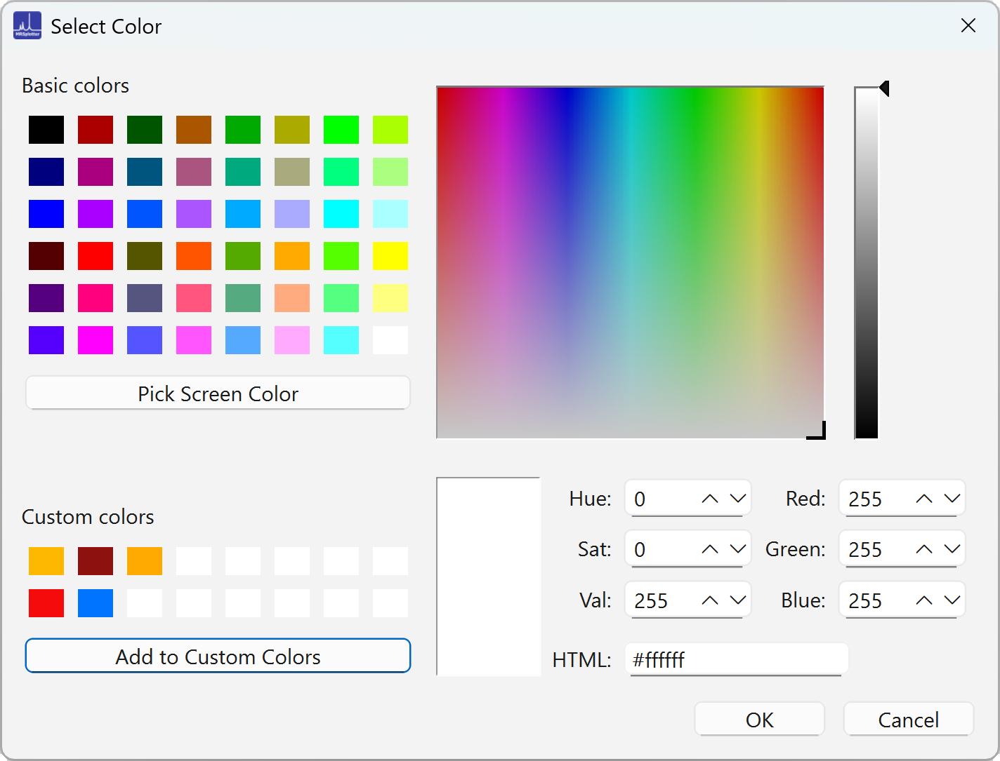
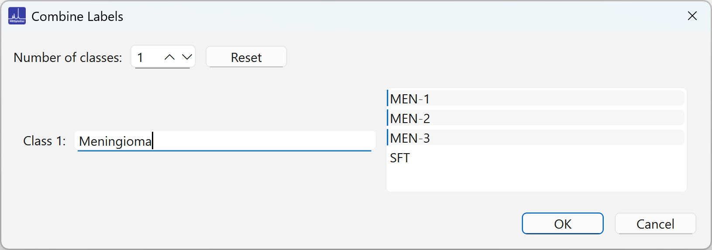
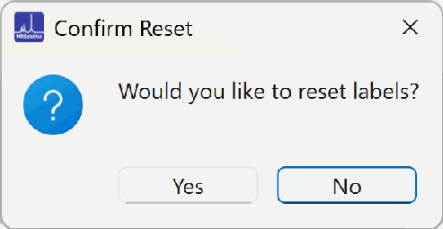
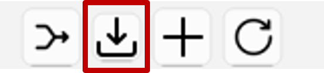
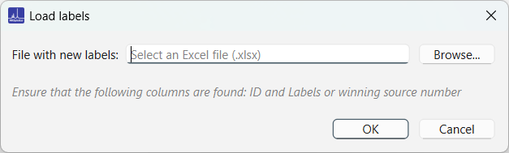
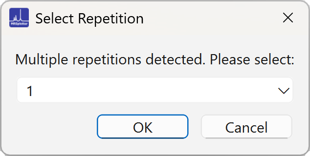
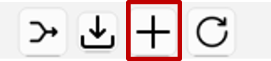
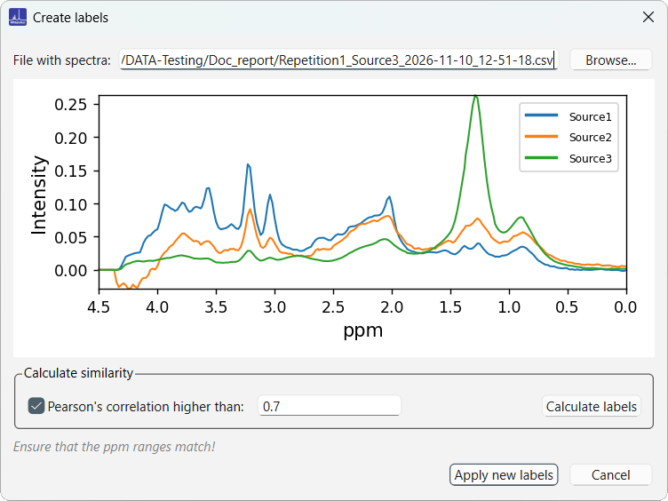
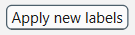
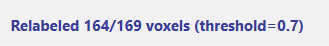

# Labels panel

Unique classes from the loaded files are listed in a list box in alphabetical order. The <kbd>Ctrl</kbd>+<kbd>A</kbd> (select all) and <kbd>Ctrl</kbd>+<kbd>D</kbd> (deselect all) shortcuts also work in the label list.

Initially, random colors are assigned to each class, but double-clicking a class opens a color picker menu, where you can assign a specific color (Figure 15):

*Figure 15. A pop-up window that allows picking colors.*

- Create custom colors by clicking one of the white squares, selecting a color, and clicking **Add to Custom Colors**. Custom colors are saved, so they can be reused after closing and reopening the application.
- Colors can also be entered as hexadecimal codes, which makes it easy to replicate previous plots.

## Combine labels

Custom labels can be created by combining the available labels into classes (Figure 16). Up to four classes can be created at the same time, and clicking **Combine Labels** again creates new combinations.

*Figure 16. A pop-up window that allows the creation of classes from labels.*

Clicking **Reset Combinations** (Figure 17) reloads the original labels with randomly assigned colors.

{width="300"}

*Figure 17. Pop-up window for confirming resetting the labels.*

## Importing labels from MRSdecomposer results

The MRSdecomposer output files contain, for each file, the X and Y positional coordinates and the winning source contribution. Using the **Load labels** {width="100"} option, this file can be used to assign labels to the input file (Figure 18).

*Figure 18. Loading the results file from MRSdecomposer.*

If multiple repetitions are detected, a pop-up window prompts you to select one of them (Figure 19).

{width="300"}

*Figure 19. Pop-up window for selecting from repetitions.*

## Creating new labels based on correlation

Click the **Calculate labels** {width="100"} button to load spectra of the same size to compare using Pearson correlation (Figure 20).

*Figure 20. Pop-up window for importing spectra for comparison.*

Labels update upon clicking the {width="100"} button. The status bar displays how many voxels were relabelled (Figure 21).

{width="300"}

*Figure 21. The status bar displays the number of spectra that were relabelled.*

Spectra with correlations below the threshold keep their original names.
