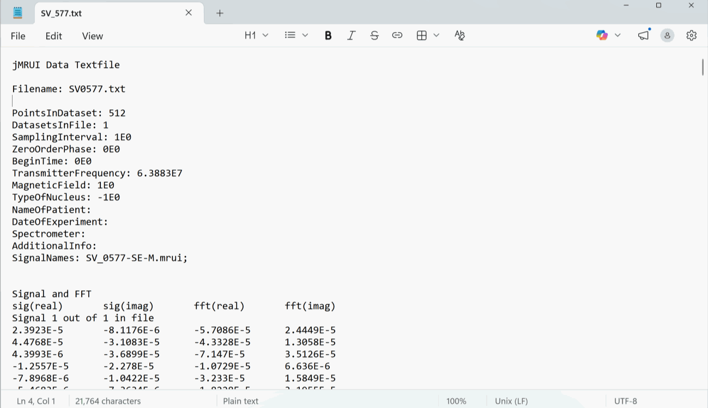
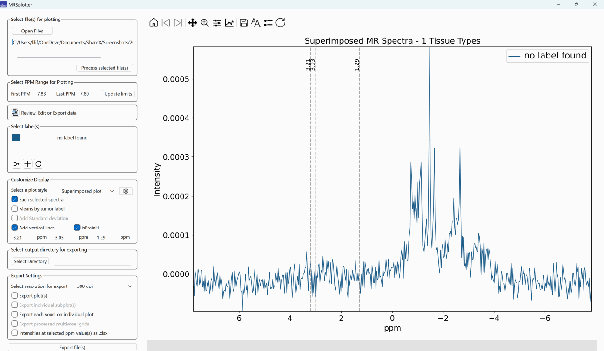
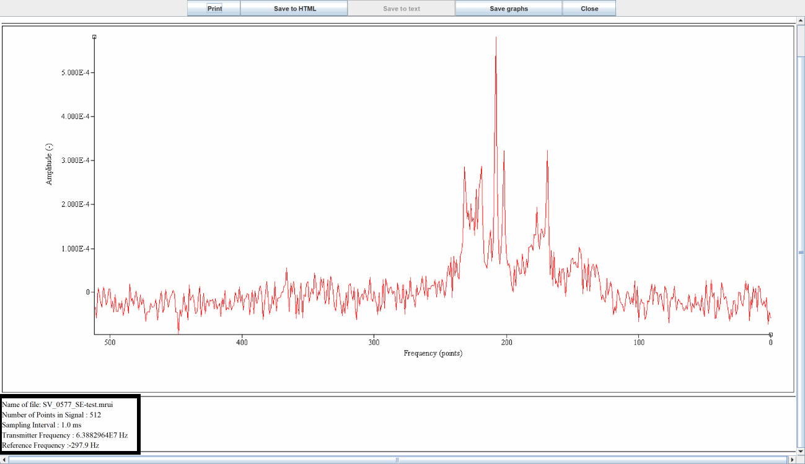
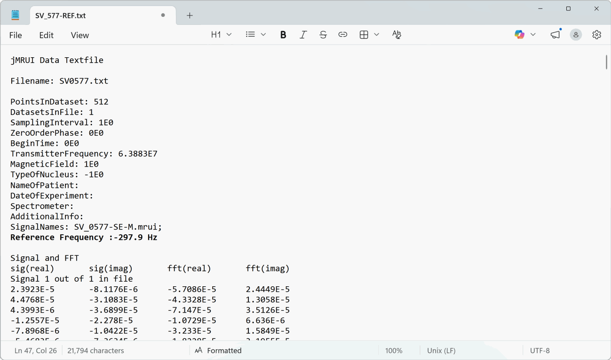
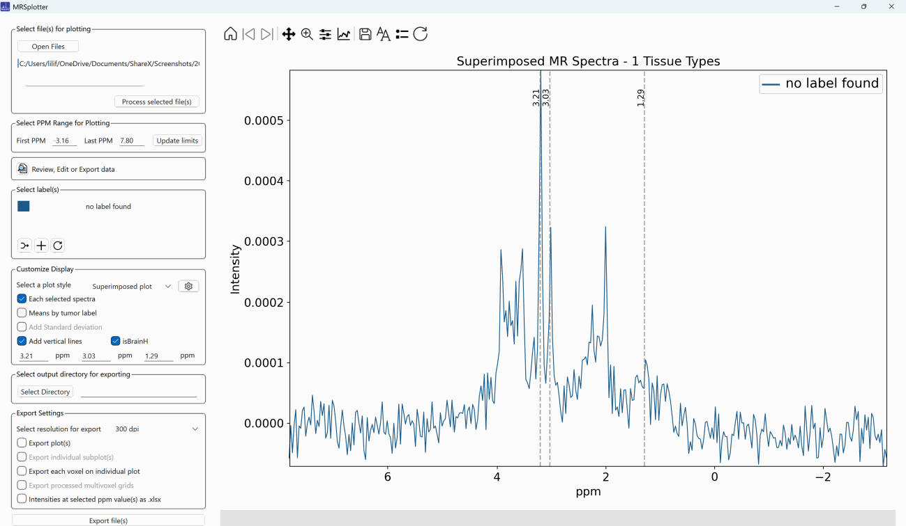
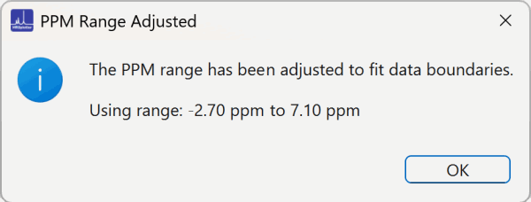
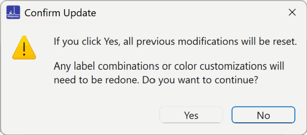

# Loading data

1. Click the **Open Files** button to select one or more files.
2. Select the files you would like to plot by clicking on them.
    - <kbd>Ctrl</kbd>+<kbd>A</kbd>: select all files
    - <kbd>Ctrl</kbd>+<kbd>D</kbd>: deselect all files
3. Click **Process selected file(s)** to load the files for plotting.
4. Upon successful loading, the labels found appear in the **Select label(s)** list box. Every spectrum is selected, and the first label found is displayed.
5. Choose the desired options from the available plotting sections.

## jMRUI Data Text files

If obtaining the XML with jMRUI2XML is not possible, the jMRUI text format (Figure 2) may be available. The header of the file contains various parameters, such as `PointsInDataset` and `TransmitterFrequency`. If the file contains multiple cases, the `DatasetsInFile` field indicates how many, and the file names are stored in the `SignalNames` field.

*Figure 2. jMRUI text format example.*

### Generation of the frequency axis

The frequency axis in ppm is calculated by determining the bandwidth in Hz from the sampling interval, then applying the Nyquist theorem to find the spectral width.

The Hz per point value is derived from this spectral width and the number of points. For each data point, the frequency is centered around zero by subtracting half the number of points from the index, multiplying by the Hz per point to obtain the frequency offset, and then adding the reference frequency. Finally, conversion from Hz to ppm is achieved by dividing each frequency by the transmitter frequency (in MHz) multiplied by 106.

!!! warning "Missing reference frequency"
    The reference frequency is not stored in the jMRUI text file, so without it the frequency axis is incorrect (Figure 3).

*Figure 3. jMRUI data file plotted without reference frequency, at 0.*

**Workaround:** in jMRUI, click **File → Print/Export**. When the window appears (Figure 4), copy the reference frequency line into the text file (Figure 5). With this additional value, the frequency axis is corrected (Figure 6).

Centering around 4.75 ppm is also an option; however, it does not work for all cases, and small shifts in the alignment are more difficult to recognize.

*Figure 4. jMRUI Print/Export window.*

*Figure 5. jMRUI text file with added reference frequency.*

*Figure 6. Corrected frequency axis.*

## Select ppm range

The default first ppm is 0.0 and the last ppm is 4.5. If the files have either the first or the last ppm out of bounds, a warning like the one in Figure 7 is displayed.

*Figure 7. Pop-up window warning that the ppm range is adjusted.*

The ppm range can be modified at any time, but reloading the data will lose all previous changes (Figure 8).

*Figure 8. A pop-up window warns that adjusting the ppm range will reload the data and reset previous settings.*
