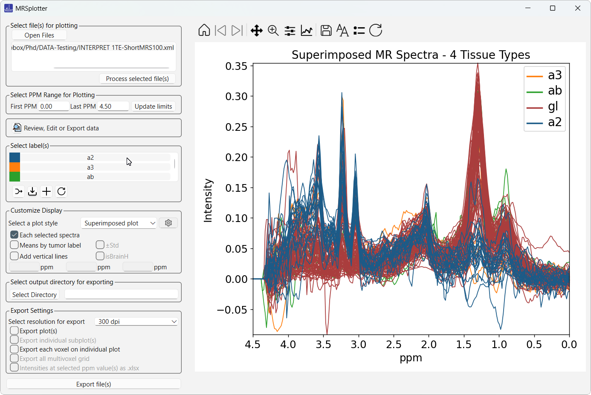
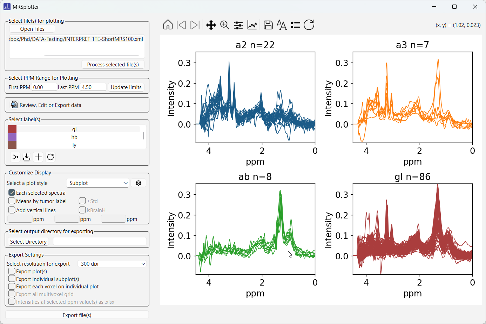
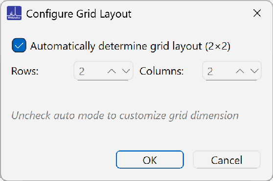
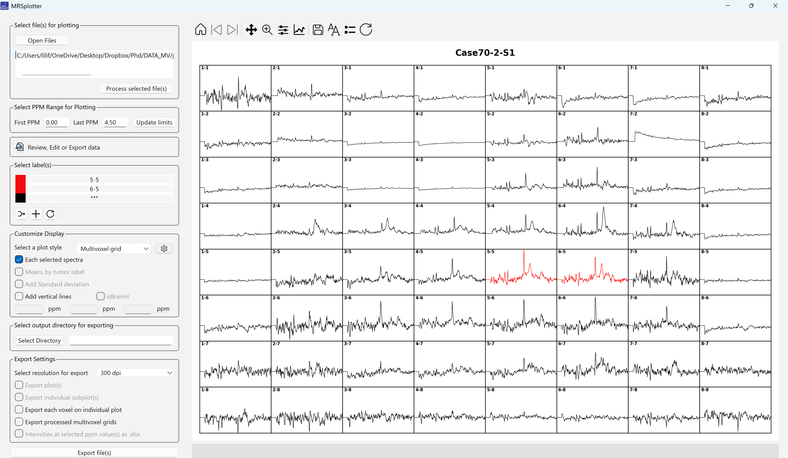

# Plot layouts

## Superimposed plots
All selected cases are shown on a single plot, with colors indicating their labels.

## Subplots
Each label is rendered on its own plot within an automatically configured grid layout.

The grid dimensions can be customized with the settings button (gear icon); see [Configure the grid size](#configure-the-grid-size-for-subplots).

### Configure the grid size for subplots

The default subplot configuration uses up to three columns, adding rows as needed to fit all plots. To change the grid dimensions, click the gear icon to open the grid configuration dialog (Figure 21). Uncheck the automatically determined grid layout option to edit the number of rows and columns. This lets you arrange the layout according to the number of spectra and your display preferences (Figure 22).

*Figure 21. Configure grid window.*

## Multivoxel grid

Available only for multivoxel cases. Displays the processed spectra for all voxels using the original grid dimensions from the source file.When multiple files are selected, only the first case is displayed by default, though additional cases can be [exported](exporting.md#export-multivoxel-grids).

