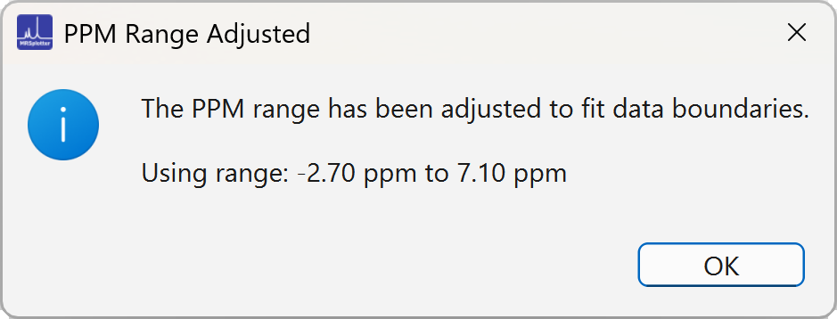
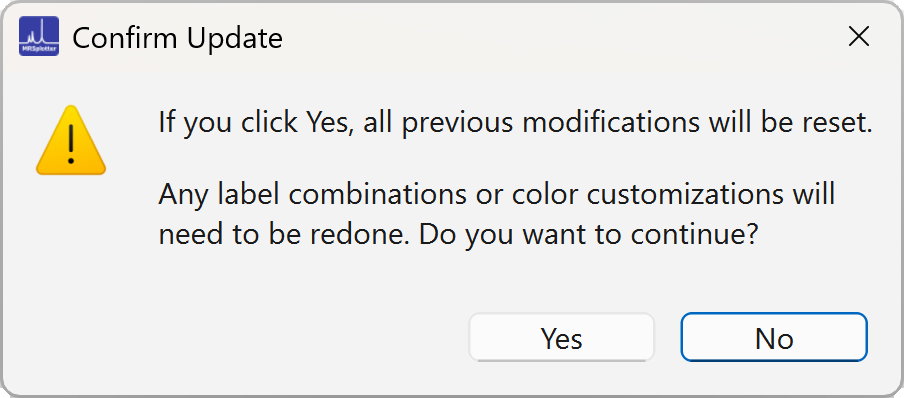

## Selecting ppm range

The default first ppm is 0.0 and the last ppm is 4.5. If the files have either the first or the last ppm out of bounds, a warning like the one in Figure 7 is displayed.

{width="400"}

*Figure 7. Pop-up window warning that the ppm range is adjusted.*

The ppm range can be modified at any time, but reloading the data will lose all previous changes (Figure 8).

{width="400"}

*Figure 8. A pop-up window warns that adjusting the ppm range will reload the data and reset previous settings.*