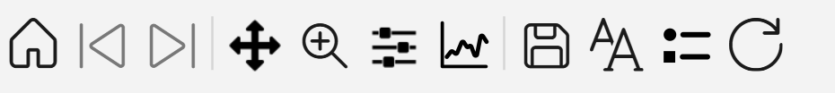
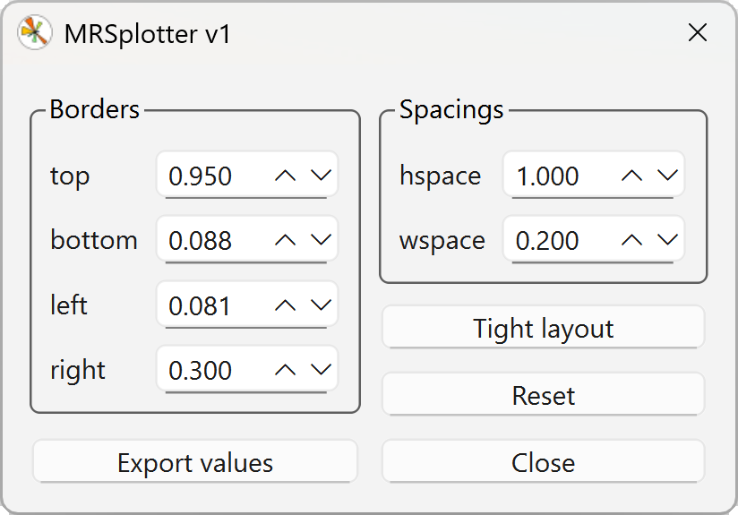
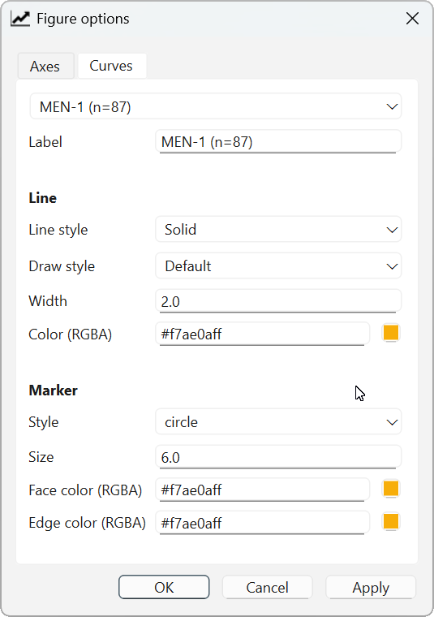
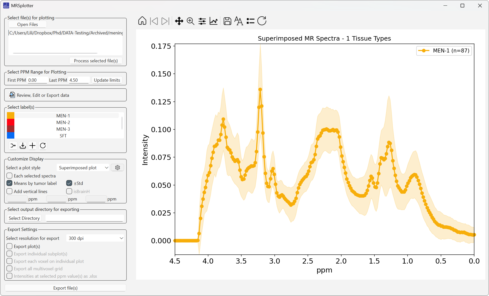

# Toolbar options

Interactive navigation uses matplotlib's interactive toolbar, with additional buttons for changing the font size, toggling the legends, and resetting the plot to its original state (Figure 29).

{width="400"}

*Figure 29. Toolbar for customizing the displayed plot.*

## Home

Resets zoom and panning to the default view.

## Forward and Back

Navigate between zoom steps. Only available after the plot has been zoomed.

## Zoom

Zooms into a selected rectangular region of the plot, including the legend.

## Configure subplots

Adjust the positions of the axes and the border margins to achieve the desired figure layout. This is particularly useful when using custom grid dimensions instead of the automatic grid (Figure 30).

{width="400"}

*Figure 30. Optimizing the layout of subplots.*

## Edit axis, curve, and image parameters

Customize individual plot elements, including axis labels, plot titles, line styles, line widths, marker sizes, and legend labels (Figure 31).

{width="400"}

*Figure 31. Axis configuration window.*

After modifying legend labels, click **Regenerate Automatic Legend** to apply the changes to the displayed legend (Figure 32).

*Figure 32. Line style changed to dotted. The legends are updated when "Regenerate Automatic Legend" is selected.*

## Save

Exports the plot as displayed in various formats, including JPEG, PNG, PDF, TIFF, and EPS, at 600 dpi.

## Change font size

Applies the selected font size to all text elements in the display. Layout adjustments may be needed after changing the font size to keep spacing and readability optimal.

## Change legend visibility

Toggles the legends on or off for all plots in the current view at once.

## Reset figure

Restores the figure to its original default state, removing all customizations and modifications.

!!! warning
    This action cannot be undone.
